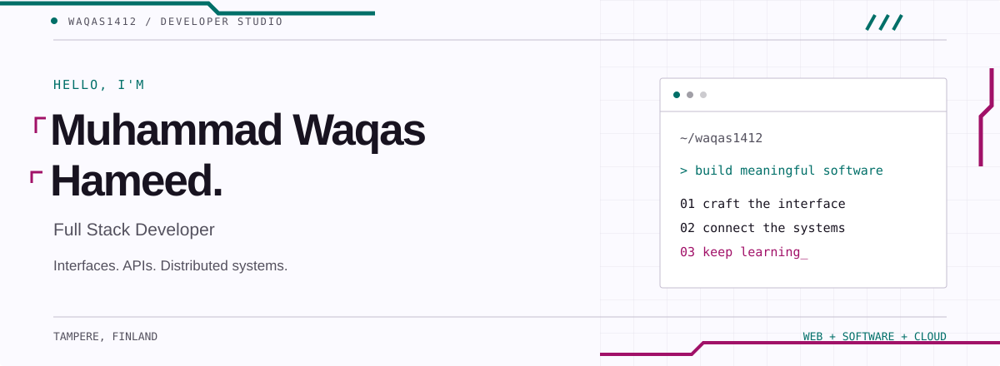

<picture>
  <source media="(max-width: 640px) and (prefers-color-scheme: dark)" srcset="./assets/hero-mobile-dark.svg">
  <source media="(max-width: 640px)" srcset="./assets/hero-mobile-light.svg">
  <source media="(prefers-color-scheme: dark)" srcset="./assets/hero-dark.svg">
  <source media="(prefers-color-scheme: light)" srcset="./assets/hero-light.svg">
  
</picture>

  <a href="https://www.linkedin.com/in/waqas1412/">LinkedIn</a> &nbsp; / &nbsp;
  <a href="mailto:muhammad.waqas1412@gmail.com">Email</a> &nbsp; / &nbsp;
  <a href="https://github.com/waqas1412?tab=repositories">Repositories</a>

<strong>Muhammad Waqas Hameed</strong> <strong>Software Engineer · Tampere, Finland</strong> Building across the web, from the interface to the services behind it.

---

## 01 / Selected work

<table>
<tr>
<td width="50%" valign="top">
<h3><a href="https://github.com/waqas1412/iot-device-manager">01 / IoT Device Manager</a></h3>

IoT dashboard spanning five services, live device metrics, and an Angular frontend.

<code>Angular</code> <code>Node.js</code> <code>TypeScript</code> <code>MongoDB</code> <code>Redis</code> <code>Docker</code>

<a href="https://github.com/waqas1412/iot-device-manager">Explore the system →</a>
</td>
<td width="50%" valign="top">
<h3><a href="https://github.com/waqas1412/react19-nexus">02 / React 19 Nexus</a></h3>

React 19 workspace with task, dashboard, and analytics modules. Exploring Actions, Suspense, and optimistic updates.

<code>React</code> <code>TypeScript</code> <code>Vite</code> <code>Tailwind CSS</code> <code>Vitest</code>

<a href="https://github.com/waqas1412/react19-nexus">Explore the workspace →</a>
</td>
</tr>
<tr>
<td width="50%" valign="top">
<h3><a href="https://github.com/waqas1412/task-manager">03 / Task Manager</a></h3>

A Java command line task manager exploring software architecture and design patterns.

<code>Java</code> <code>CLI</code> <code>Design patterns</code>

<a href="https://github.com/waqas1412/task-manager">Explore the application →</a>
</td>
<td width="50%" valign="top">
<h3><a href="https://github.com/waqas1412/emote-system-kafka">04 / Emote System</a></h3>

A distributed reaction system connecting a React interface with Node.js services and Apache Kafka.

<code>React</code> <code>Node.js</code> <code>Kafka</code> <code>Event-driven systems</code>

<a href="https://github.com/waqas1412/emote-system-kafka">Explore the architecture →</a>
</td>
</tr>
</table>

## 02 / Tools I work with

| Layer | Technologies |
| :--- | :--- |
| **Interfaces** | React · Angular · TypeScript · JavaScript · HTML · CSS · SCSS |
| **Services** | Node.js · .NET · C# · Java |
| **Data & messaging** | MongoDB · Redis · Apache Kafka |
| **Delivery & tooling** | Docker · Git · GitHub · Postman |

## 03 / A little context

I'm Muhammad Waqas Hameed, a full stack developer based in **Tampere, Finland**. My work and projects span frontend applications, backend APIs, and distributed systems.

I hold an **MSc in Software, Web & Cloud from Tampere University**, with a **4.78/5.00 GPA**. I'm continuing to explore cloud technologies and microservices, and I'm open to thoughtful conversations, collaboration, and interesting opportunities.

<strong>Education & background</strong>

 

| Qualification | University | Period | GPA |
| :--- | :--- | :--- | :--- |
| MSc, Software, Web & Cloud | Tampere University, Finland | Aug 2024 – Dec 2025 | 4.78/5.00 |
| BSc, Computer Science | International Islamic University Islamabad | 2017 – 2021 | 3.41/4.00 |

My path in technology took me from Pakistan to Finland. I enjoy connecting with the Finnish and European tech communities.

<strong>More projects to explore</strong>

 

### Full stack & APIs

| Project | Focus |
| :--- | :--- |
| [NZWalks](https://github.com/waqas1412/NZWalks) | ASP.NET Core API, JWT authentication, and role based authorization |
| [Bulky](https://github.com/waqas1412/Bulky) | E-commerce application with ASP.NET Core MVC |
| [YelpCamp](https://github.com/waqas1412/YelpCamp) | Campground reviews and sharing |
| [EmployeeManagement](https://github.com/waqas1412/EmployeeManagement) | Learning ASP.NET Core |

### Frontend & learning

| Project | Focus |
| :--- | :--- |
| [Recipe Book](https://github.com/waqas1412/Recipe-Book) | Angular, NgRx, and Firebase |
| [React Expense Tracker](https://github.com/waqas1412/React-Expense-Tracker) | Expense tracking with interactive charts |
| [Food Order App](https://github.com/waqas1412/food-order-app) | A React food ordering interface |
| [NgRx](https://github.com/waqas1412/NgRx) | State management practice |
| [MEAN Project](https://github.com/waqas1412/MEAN_Project) | MongoDB, Express, Angular, and Node.js |

[Browse all repositories →](https://github.com/waqas1412?tab=repositories)

---

  <strong>Have something interesting in mind?</strong> 
  Let's talk about software, systems, or what you're building.  
  <a href="mailto:muhammad.waqas1412@gmail.com"><strong>muhammad.waqas1412@gmail.com</strong></a> 
  <a href="https://www.linkedin.com/in/waqas1412/">Connect on LinkedIn →</a>

